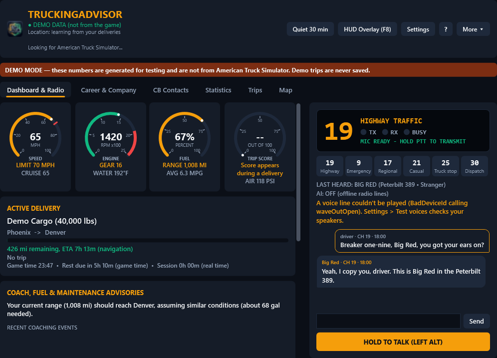

# TruckingAdvisor

A Windows companion app for **American Truck Simulator** (and ETS2), grown out of [SimCoach](https://github.com/Jcedwar61/SimCoach). It reads live game telemetry, coaches your driving, scores each delivery, tracks your career, and adds an AI-powered CB radio with recurring trucker characters.

Everything except the AI radio works offline with no account. If AI is off or unavailable, the radio falls back to short offline lines and nothing else is affected.



<sub>Screenshots are rendered automatically from the latest build using demo data. More: [career](https://raw.githubusercontent.com/Jcedwar61/TruckingAdvisor/ci-screenshots/career.png) · [CB contacts](https://raw.githubusercontent.com/Jcedwar61/TruckingAdvisor/ci-screenshots/contacts.png) · [statistics](https://raw.githubusercontent.com/Jcedwar61/TruckingAdvisor/ci-screenshots/statistics.png)</sub>

## Quick start

1. Download **TruckingAdvisor-Setup-2.7.0.exe** from the [latest release](https://github.com/Jcedwar61/TruckingAdvisor/releases/latest) and run it. It installs for your Windows account only (no admin prompt) and needs 64-bit Windows 10 or 11. .NET doesn't need to be installed.
   - Windows SmartScreen may warn because the installer isn't code-signed: choose **More info > Run anyway**.
2. Start TruckingAdvisor. It searches every drive for American Truck Simulator (and ETS2): Steam's registry entries and library list, Windows' installed-programs list, and common folders like `D:\SteamLibrary`. If the telemetry plugin is missing it offers to install it. If the game isn't found, **Install Telemetry Plugin** lets you pick the game folder.
3. Start ATS. The header shows **CONNECTED TO ATS** once data flows.
4. Optional: **AI & Radio Settings** → enable AI, paste your OpenAI key, turn on the microphone, set your CB handle.

No game handy? Use the **TruckingAdvisor (demo data)** Start-menu shortcut. Demo values are clearly bannered and never saved.

The window can be resized and maximized (drag the divider between the dashboard and the radio), and it remembers its size and position. **Move/Resize HUD** unlocks the in-game overlay so you can drag and resize it; lock it again for click-through play.

## Features

| Area | What you get |
| :--- | :--- |
| Dashboard | Speed and posted limit (turns red when over), RPM, gear, cruise, fuel %, range, average MPG, air pressure, water temp, delivery progress, game time, rest timer. Unknown values show `--`. |
| Driving coach | Speeding tiers (1–5 / 6–10 / 11+ over), harsh braking, aggressive throttle, over-revving (based on your engine's max RPM), parking brake while rolling, low air while moving, overheating, critical fuel, serious damage. Deterministic rules with cooldowns. |
| Audio priority | One voice at a time. Critical alerts cut off radio chatter; normal messages wait while the radio is busy. |
| Deliveries | Detects job start, cargo attached, underway, trailer dropped, delivered, cancelled, and starting mid-delivery. Distance from the odometer, fuel from the tank, damage as the increase during the trip. |
| Scoring | 10 categories, normalized per 100 miles; ratings from Needs Improvement to Legendary Trucker. Delivery report as text, JSON or CSV. |
| Career & company | Your company's miles, deliveries, damage-free rate, in-game income, MPG and cities, plus XP levels (Rookie Driver to Legendary Trucker), 8 achievements and 4 company milestones with progress, personal insights from your history, and MPG per truck. Starts at zero and only counts trips this app recorded. |
| Fuel & maintenance | Low-fuel and range-to-destination advice, MPG vs. last trip, engine/trailer damage, service due (from your service log), rest reminders, deadline risk from the navigation estimate. Real-time session length is shown next to the game's rest timer. |
| Co-driver | Onboard voice with 5 personalities (Professional, Friendly, Old-School Trucker, Strict Instructor, Minimal). Critical warnings stay plain in every personality; Minimal only speaks serious ones. No radio effects, so it never sounds like the CB. |
| CB radio | Channels 19, 9, 17, 21, 25 and 30 (dispatch). Hold push-to-talk (Left Alt by default) or type. Five recurring truckers plus up to four generated ones; they remember you, mention each other (radio gossip), and relationships grow from Stranger to Old Friend based on conversation quality and coming back over days. Conversation modes (Brief, Natural, Chatty, Quiet, Immersive), background chatter levels, an hourly cap on unprompted calls, relaxed truck-stop talk when you're parked, AI-to-AI exchanges in one API call, CB audio filter with a clean-audio option. CB Contacts tab shows each trucker and what they remember; you can make them forget. |
| Dispatcher | A named dispatcher (default "Sarah") who briefs you on new loads, checks in at your chosen frequency, and calls about approaching the destination, low fuel vs. distance, rest, new damage and deadline risk, then wraps up each delivery. Dispatch and CB truckers don't share what you told the other. |
| Voice commands | Say "TruckingAdvisor, ..." to switch channels, call dispatch, ask fuel range or distance left, change radio volume, mute/unmute or repeat. Introduce yourself on the radio ("call me Highway Ghost") and the app offers to save your handle. |
| HUD overlay | Small click-through, always-on-top panel (F8). Unlock it to drag and resize (text scales), choose which rows it shows (speed, limit, fuel, range, remaining, score, location, grade ahead, radio) and its opacity. A CB channel picker sits under it: click it to pick a channel, or press `[` / `]` in game to step through channels (the list pops open briefly so you can see where you landed). The picker takes clicks but never takes focus from the game. Works over the game in borderless/windowed mode. |
| Statistics & exports | Trend charts for driver score, MPG, coaching events per 100 miles and trip distance. Export a trip as PDF, a shareable PNG report card, JSON or text; all trips as CSV or PDF. |
| Look & layout | Themes (Midnight, Charcoal, Slate Light) and accent colors; reorder or hide dashboard widgets and individual gauges (Layout & Theme). Resizable window with a draggable divider. |
| Learned location & grades | The game doesn't report your city or the road ahead, so TruckingAdvisor learns them from your own driving: city positions from where your jobs start and end (shown as "in/near Denver, CO"), and steep downgrades you've driven, so it warns you when you're heading toward one again. Unknown places stay unknown. |

### About the radio

The truckers are simulated radio characters. ATS doesn't expose nearby traffic, so they never claim to see you, traffic, police or weather. They only mention your load, fuel or speed when the game reported it.

## AI setup and cost

Two voice pipelines (AI & Radio Settings): **Modular** (speech-to-text → chat → text-to-speech; cheapest) or **Realtime** (one OpenAI speech-to-speech session; faster and more natural, costs more, falls back to Modular if it fails). App commands still work in both. Without OpenAI, Windows' built-in offline speech recognition turns your push-to-talk into text, so voice commands and offline radio replies work with no internet. Model names are settings:

| Setting | Default |
| :--- | :--- |
| Chat | `gpt-5.4-mini` |
| Realtime voice (optional) | `gpt-realtime-mini` |
| Transcription | `gpt-4o-mini-transcribe` |
| Voice | `gpt-4o-mini-tts` (or free Windows voices) |

Check OpenAI's model list for retirement dates and update these when needed. The app counts every request and token, enforces a daily request limit (default 300) and, once you enter prices from openai.com/api/pricing, a daily dollar limit. Your OpenAI dashboard is the source of truth for billing.

Your key is encrypted with Windows DPAPI. See [SECURITY.md](SECURITY.md).

## Telemetry sources

Requires [RenCloud/scs-sdk-plugin](https://github.com/RenCloud/scs-sdk-plugin) **V.1.12.x** (layout revision 12) in `<game>\bin\win_x64\plugins`. Other revisions are refused with a clear message rather than misread.

| Kind | Fields |
| :--- | :--- |
| Direct (from the game) | Speed, speed limit, RPM, max RPM, gear, throttle/brake/clutch, engine/electric state, parking brake, engine brake, retarder, cruise state and speed, fuel and capacity, average consumption, game range, air/oil pressure (psi), water temp, warning lights, engine/transmission/cabin/chassis/wheel wear, trailer attached and wear, cargo damage, cargo name and mass, origin/destination city and company, planned distance, navigation distance and time, job income, deadline, delivered/cancelled events, world position and heading, odometer, game time, time scale, minutes until rest |
| Calculated by TruckingAdvisor | MPG from game consumption, instant MPG (fuel vs. odometer), range fallback, road grade (from position, approximate), trip distance/fuel/time/averages, damage added during a trip, scores, career stats |
| Not available | Current city and state (the SDK doesn't report them), nearby traffic, weather, road grades ahead. A map integration could add these later. |

## Project layout

```
TruckingAdvisor.sln
src/
  TruckingAdvisor.Shared        models, enums, interfaces
  TruckingAdvisor.Telemetry     shared-memory layout, parser, reader, game finder (any drive), plugin installer
  TruckingAdvisor.Core          driving coach, scoring, trip tracker, career, fuel/maintenance advisor, audio priority
  TruckingAdvisor.AI            OpenAI client, CB radio, personalities, memory/relationships, context builder, usage limits
  TruckingAdvisor.Audio         Windows playback with CB filter, microphone, push-to-talk hook
  TruckingAdvisor.Data          SQLite storage and report exports
  TruckingAdvisor.Presentation  dashboard view-model (no WPF dependency, so it's testable)
  TruckingAdvisor.UI            WPF window, settings dialog, HUD overlay
tests/TruckingAdvisor.Core.Tests
installer/                                Windows installer (NSIS) and build script
Plugins/plugin_manifest.json              pinned telemetry plugin release
```

## Limits

- Location and grade warnings only cover places and roads you've driven with TruckingAdvisor running; there is no game map data.
- Offline speech recognition needs an English speech recognizer installed in Windows and is less accurate than OpenAI.
- The installer isn't code-signed, so SmartScreen shows a warning the first time.
